<!-- ===================== HEADER ===================== -->
<p align="center">
  
</p>

<p align="center">
  <a href="https://github.com/maryam-farhoune">
    
  </a>
</p>

<p align="center">
  <a href="https://www.linkedin.com/in/maryam-farhoune/"></a>
  
  
</p>

---

## 👩‍💻 About Me

```python
class MaryamFarhoune:
    school     = "EMSI — Engineering, AI & Data (IAD), 4th year"
    experience = "OCP Group — Predictive maintenance on industrial turbocompressors"
    building   = "MaintiDoc — multimodal agentic RAG for maintenance documentation"
    focus      = ["Machine Learning", "Deep Learning", "Generative AI", "Data Engineering"]
    looking_for = "4–6 month End-of-Studies Internship (PFE), starting 2027"

    def mission(self):
        return "Turn raw industrial data into models, dashboards and AI assistants that people actually use."
```

---

## 🚀 Featured Projects

<table>
  <tr>
    <td width="50%" valign="top">
      <h3>🤖 <a href="https://github.com/maryam-farhoune/MAINTiDOC">MaintiDoc</a></h3>
      <p>Multimodal <b>agentic RAG</b> assistant answering technicians' questions from maintenance manuals — text, tables and diagrams.</p>
      
      
      
      
    </td>
    <td width="50%" valign="top">
      <h3>🏭 Predictive Maintenance — OCP Group</h3>
      <p>Unsupervised anomaly detection on <b>8 vibration sensors</b> of industrial turbocompressors: 42 engineered features, <b>Isolation Forest</b> cross-validated with <b>LOF</b>, temporal analysis of anomaly episodes, Streamlit + Power BI dashboards.</p>
      
      
      
      
    </td>
  </tr>
  <tr>
    <td width="50%" valign="top">
      <h3>🧠 <a href="https://github.com/maryam-farhoune/deep_learning_project">Deep Learning Multi-modalities</a></h3>
      <p>Comparative study of <b>MLP, CNN and RNN/LSTM/GRU</b>, with experiments on gradient clipping, Seq2Seq and internal representations.</p>
      
      
    </td>
    <td width="50%" valign="top">
      <h3>🎨 <a href="https://github.com/maryam-farhoune/Modeles_Generatifs">Generative Models</a></h3>
      <p>Implementation and experiments with <b>deep generative models</b>.</p>
      
      
    </td>
  </tr>
  <tr>
    <td width="50%" valign="top">
      <h3>💄 Cosmetic Recommendation System</h3>
      <p>Personalized recommender based on skin type and ingredients over a <b>1,472-product</b> dataset.</p>
      
      
    </td>
    <td width="50%" valign="top">
      <h3>📄 OCR Information Extraction</h3>
      <p>Computer-vision pipeline extracting and structuring data from complex documents.</p>
      
      
    </td>
  </tr>
</table>

---

## 🛠️ Tech Stack

<table>
  <tr>
    <td align="center" width="25%"><b>ML / DL</b></td>
    <td></td>
  </tr>
  <tr>
    <td align="center"><b>GenAI</b></td>
    <td>
      
      
      
    </td>
  </tr>
  <tr>
    <td align="center"><b>Data & Big Data</b></td>
    <td>
      
      
    </td>
  </tr>
  <tr>
    <td align="center"><b>Viz & BI</b></td>
    <td>
      
      
      
    </td>
  </tr>
  <tr>
    <td align="center"><b>Backend & Tools</b></td>
    <td></td>
  </tr>
</table>

---

## 📈 GitHub Activity

<p align="center">
  
</p>

<p align="center">
  <picture>
    <source media="(prefers-color-scheme: dark)" srcset="https://raw.githubusercontent.com/maryam-farhoune/maryam-farhoune/output/github-snake-dark.svg" />
    <source media="(prefers-color-scheme: light)" srcset="https://raw.githubusercontent.com/maryam-farhoune/maryam-farhoune/output/github-snake.svg" />
    
  </picture>
</p>

---

## 🎓 Education & Certifications

| | |
|---|---|
| 🎓 **Engineering Degree — AI & Data (IAD)** | EMSI · *expected 2027* |
| 🏭 **Data Science Internship** | OCP Group · *2026* |
| 📜 **Agile Project Management** | Coursera |
| 📜 **Data Science Foundations** | Coursera |

---

<p align="center">
  <i>Open to collaborations on ML, GenAI and industrial AI — let's connect on <a href="https://www.linkedin.com/in/maryam-farhoune/">LinkedIn</a>.</i>
</p>

<p align="center">
  
</p>
